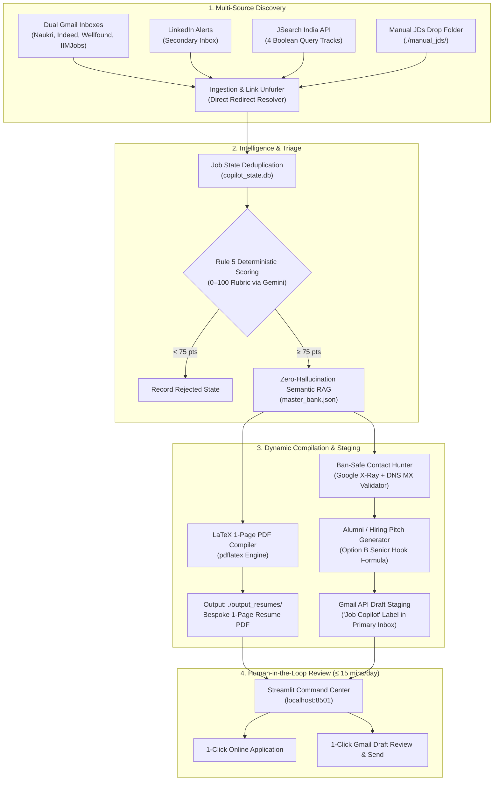

# 🚀 PM Career Copilot: Autonomous Career Transition Engine

> **A Human-in-the-Loop (HITL) AI System for Hyper-Personalized PM Applications & High-Converting Alumni Referrals at Scale**  
> **Candidate & Builder:** [Jaivik Chauhan](https://www.linkedin.com/in/jaivik-chauhan) | MBA (IIM Indore '25) + B.Tech IT (VIT Vellore '23) | Ex-IQVIA Strategy Consulting, Bain & Co. Summer Associate  
> **Target Roles:** APM, PM-1, Growth PM, Technical PM, Digital PM, Product Operations & Strategy (India)

[](https://www.python.org/)
[](https://ai.google.dev/)
[](https://www.latex-project.org/)
[](https://streamlit.io/)
[](https://developers.google.com/gmail/api)
[](#non-negotiable-product-guardrails)

---

## 📌 Executive Summary & The "Why"

### The Problem in Modern Tech Recruiting
In today's tech hiring landscape, the top-of-funnel job search is fundamentally broken:
1. **The ATS Keyword Black Hole:** High-potential candidates with hybrid backgrounds (e.g., Management Consulting + IT Engineering transitioning into Product Management) get discarded by algorithmic ATS keyword matchers before a human ever views their application.
2. **The Mass-Apply Spam Trap:** Off-the-shelf auto-apply bots blindly spray generic resumes across hundreds of job boards. This triggers platform shadowbans on LinkedIn/Indeed, pollutes recruiter inboxes, and results in near-zero conversion.
3. **The Calendar Friction of "Coffee Chats":** Cold networking messages asking busy leaders for a "15-minute coffee chat" experience low response rates due to calendar congestion.

### The Strategic Solution: Hyper-Personalization at Scale
**Targeted quality strictly beats spray-and-pray volume.**  
Instead of sending 500 generic applications, **PM Career Copilot** executes an authentic, high-leverage strategy:
- **1 Bespoke, Verifiable 1-Page LaTeX PDF Resume** tailored specifically to the target role's core competencies using zero-hallucination semantic RAG.
- **1 Warm, Non-AI Internal Referral Request** directed to an alumnus (IIM Indore / VIT Vellore) or hiring manager, framed around mutual campus camaraderie, hands-on prototype building, and direct referral submission.
- **Human-in-the-Loop Protocol:** The entire workflow is automated, but the human retains 100% final approval—completable in **$\le 15$ minutes per day**.

---

## 🏗️ System Architecture & Workflow



---

## ⚡ Core Features & Capabilities

### 1. Dual-Inbox Gmail Alert & Recruiter Ingestor (`gmail_ingestor.py`)
- **Dual-Account Architecture:** Scans primary inbox (`jaivik.chauhan.2026@gmail.com`) for portal digests (Naukri, Indeed, Wellfound, IIMJobs) and secondary inbox (`jaivik.sedsvit@gmail.com`) for LinkedIn alerts and campus announcements.
- **Direct Link Unfurling:** Preserves HTML hyperlinks from digests and resolves HTTP redirects to canonical ATS destination URLs (Greenhouse, Lever, Ashby, Workday) with zero search quota consumption.
- **Direct Recruiter Reply:** Detects inbound recruiter emails, parses PDF/DOCX attachments, and stages tailored direct replies.

### 2. Multi-Track JSearch India Aggregator (`dossier_bridge.py`)
- Executes 4 quota-safe Boolean query tracks across India for 7 high-impact PM target archetypes:
  1. *Associate Product Manager (APM), Product Manager (PM-1), Product Owner*
  2. *Technical Product Manager (TPM), AI Product Manager*
  3. *Digital Product Manager, Product Operations Manager, Product Strategy Manager*
  4. *Growth Product Manager, Product Marketing Manager (B2B/GTM Focus)*

### 3. Deterministic 100-Point Fit Scoring (`triage_and_build.py`)
Replaces opaque LLM outputs with an audited, deterministic Rule 5 scoring model:
- **YoE & Role Archetype (0–30 pts):** Full 30 pts for 0–3 YoE target PM roles; 10–15 pts for 3–4 YoE; 0 pts (auto-reject) for senior/director roles or non-product sales/media-buying positions.
- **Competency Overlap (0–50 pts):** 10 pts for each of the JD's top 5 core requirements mapping to verified competencies (SQL, PRD authoring, 0-to-1 MVP scoping, user stories, GTM launch, AI/LLM product design, KPI frameworks).
- **Domain Bridge (0–20 pts):** 20 pts for AI/Data PM, B2B SaaS, HealthTech, Consumer Tech; 10 pts for general digital PM.
- **Gating Rule:** Only roles scoring **$\ge 75/100$** trigger resume compilation and outreach staging.

### 4. Zero-Hallucination Semantic RAG & LaTeX Compilation
- **Zero Hallucination Guarantee:** Bullet points are **never generated, rewritten, or embellished** by an LLM. Resume achievements are selected verbatim from `master_bank.json` (verified metrics from IQVIA consulting, Bain CoE, JLL SDE, and Uber PRD).
- **Strict 1-Page Geometry:** Dynamically populates `%DYNAMIC_*_BULLETS%` placeholders inside `template.tex` and compiles via local `pdflatex` under strict margin constraints (0.4in left/right, 0.35in top/bottom, 9.5pt font).

### 5. Ban-Safe Alumni Discovery & High-Converting Pitch Drafter (`outreach_drafter.py`)
- **Anti-Ban Architecture:** Zero browser scraping on LinkedIn. Uses Google X-Ray search queries and DNS MX record validation to identify verified contacts while protecting sender domain reputation.
- **High-Converting Option B Referral Pitch:** Automatically detects alumni status (`is_alum`: IIM Indore / VIT Vellore) and crafts a respectful, non-salesy message highlighting campus senior camaraderie, hands-on prototype building (AI agents / vibe coding), and a direct internal referral ask:

```text
Subject: Fellow IIM Indore alum — Growth PM opening at Swiggy

Hi Rahul,

Always great to connect with an IIM Indore senior! I was searching for alums doing great work in product on LinkedIn and came across your profile, and also noticed the open Growth PM role at Swiggy.

I'm currently at IQVIA in strategy consulting and actively working to transition into product management. A quick snapshot:
• Background: B.Tech in IT (VIT Vellore) + MBA (IIM Indore '25)
• Hands-on Builder: Passionate about product since engineering; actively building prototypes with AI agents / vibe coding, and driving workflow automations at IQVIA

I’ve attached my tailored 1-page resume—would you be open to submitting an internal referral for this opening, or pointing me toward the hiring manager?

Thank you so much,
Jaivik Chauhan
+91-7016175705 | linkedin.com/in/jaivik-chauhan
```

### 6. Executive Streamlit Command Center (`dashboard.py`)
- Interactive real-time web portal running on `http://localhost:8501`.
- Provides 1-click `Apply ↗` links, direct links to alumni LinkedIn profiles, 1-click downloads for compiled 1-page resumes, and kanban application tracking.

---

## 🛡️ Non-Negotiable Product Guardrails

| Guardrail | Implementation | Purpose |
| :--- | :--- | :--- |
| **🚫 Zero Hallucination** | Resume bullets selected verbatim from `master_bank.json` | Eliminates AI fabrication; ensures 100% interview-defensible claims |
| **📄 Strict 1-Page LaTeX** | Local `pdflatex` compilation with fixed geometry constraints | Guarantees clean, professional typography with zero page overflow |
| **🛡️ Anti-Ban Design** | No Selenium/Playwright LinkedIn scrapers; Google X-Ray + JSearch API only | Eliminates account termination risks on LinkedIn and job portals |
| **🔑 Sacred HITL Protocol** | Gmail API creates drafts under `Job Copilot` label; never auto-sends | Human makes all final submission and messaging decisions |
| **⏱️ 15-Minute Budget** | Morning runner consolidates all tasks into one action table | Keeps the job hunt sustainable alongside a full-time consulting workload |

---

## 📈 Real-World Performance & Funnel Metrics

Data recorded in `copilot_state.db` from live execution runs:

| Funnel Stage | Metric | Impact & Conversion |
| :--- | :---: | :--- |
| **Raw Opportunities Evaluated** | **309** | Broad coverage across 6 major portals and JSearch India |
| **Rule 5 Qualified Roles ($\ge 75$)** | **67** | High-signal filter (78% noise eliminated before human review) |
| **Bespoke 1-Page PDFs Compiled** | **67** | Pixel-perfect, role-tailored resumes in `./output_resumes/` |
| **Live Gmail Referral Drafts Staged** | **45** | High-converting alumni & decision-maker outreach ready in drafts |
| **Platform Bans / Shadowbans** | **0** | 100% compliant with LinkedIn & job portal terms of service |
| **Daily Human Review Time** | **$\le$ 15 mins** | Reduced manual search and drafting overhead by **> 90%** |

---

## 📂 Repository Directory Layout

```text
pm-career-copilot/
├── daily_hunt.py            # Master 1-command morning execution workflow
├── dashboard.py             # Streamlit Interactive Command Center UI
├── gmail_ingestor.py        # Dual-inbox job alert parser & Google resolver
├── dossier_bridge.py        # Multi-track JSearch India aggregator & state coordinator
├── triage_and_build.py      # Rule 5 deterministic fit scoring & LaTeX 1-page PDF compiler
├── outreach_drafter.py      # Ban-safe contact hunter, MX checker & Gmail draft stager
├── auth_gmail_server.py     # Local OAuth 2.0 authentication server for primary/secondary Gmail
├── master_bank.json         # Single source of truth for verified achievements & metrics
├── template.tex             # LaTeX resume template with dynamic injection placeholders
├── manual_jds/              # Drop folder for offline or ad-hoc job descriptions
├── output_resumes/          # Generated bespoke 1-page PDF resumes & .tex source files (gitignored)
├── tests/                   # Integration and regression test suite (test_gmail_ingestor.py)
├── copilot_state.db         # SQLite state database tracking all evaluated jobs & draft IDs (gitignored)
├── requirements.txt         # Python project dependencies
├── .env.example             # Template for required environment variables
└── README.md                # System documentation & product specification
```

---

## 🚀 Quickstart & Setup Guide

### 1. Prerequisites
- **Python 3.11+** installed.
- **LaTeX Distribution:** [MiKTeX](https://miktex.org/) (Windows) or [TeX Live](https://tug.org/texlive/) (macOS/Linux) with `pdflatex` available in your system `PATH`.

### 2. Installation
```bash
# Clone the repository
git clone https://github.com/jaiviksedsvit-coder/pm-career-copilot.git
cd pm-career-copilot

# Create and activate a virtual environment
python -m venv venv
source venv/bin/activate  # On Windows: .\venv\Scripts\activate

# Install required dependencies
pip install -r requirements.txt
```

### 3. Configure Environment Variables
Copy `.env.example` to `.env` and provide your API keys:
```bash
cp .env.example .env
```
Edit `.env`:
```ini
GEMINI_API_KEY="your-google-gemini-api-key"
RAPIDAPI_KEY="your-rapidapi-jsearch-key"
SERPER_API_KEY="your-serper-api-key"  # Optional
```

### 4. Authenticate Gmail API (OAuth 2.0)
Place your Google Cloud client credentials JSON file in the project root as `credentials.json`, then authorize your accounts:
```bash
# Primary account (Outreach drafts & portal alerts)
python auth_gmail_server.py --account primary

# Secondary account (LinkedIn alerts & campus inbox)
python auth_gmail_server.py --account secondary
```

### 5. Run Today's Morning Hunt
Execute the complete ingestion, scoring, compilation, and draft staging pipeline:
```bash
python daily_hunt.py
```
*Optional Flags:*
- `--dry-run`: Run the pipeline and evaluate jobs without creating live Gmail drafts.
- `--open-urls`: Automatically open all qualifying application URLs in your default browser.
- `--stats`: Print an executive database audit trail of all processed roles.

### 6. Launch the Interactive Command Center
```bash
streamlit run dashboard.py
```
Open [http://localhost:8501](http://localhost:8501) to view your daily priority queue, download compiled resumes, and track application statuses.

---

## 👨‍💻 About the Candidate & Builder

**Jaivik Chauhan** is a Product Management candidate bridging **Management Consulting rigor** with an **Engineering foundation** and **modern hands-on AI prototyping**.

- **Education:**
  - **MBA (General Management):** Indian Institute of Management (IIM) Indore (Class of 2025, Top 15%)
  - **B.Tech (Information Technology):** VIT Vellore (Class of 2023, 9.19 CGPA, Merit Scholarship)
- **Experience:**
  - **Associate Consultant at IQVIA:** Strategy consulting driving data analytics, workflow automation, and 0-to-1 digital solutions.
  - **Summer Associate at Bain & Company:** Tech & Cloud Center of Excellence (market entry, cloud migration frameworks).
  - **SDE Intern at JLL Technologies:** Built full-stack microservices and automated deployment pipelines.
- **Connect:**
  - **LinkedIn:** [linkedin.com/in/jaivik-chauhan](https://www.linkedin.com/in/jaivik-chauhan)
  - **Email:** `jaivik.chauhan.2026@gmail.com` | `jaivik.sedsvit@gmail.com`

---

## 📄 License
This project is open-source under the [MIT License](LICENSE).
